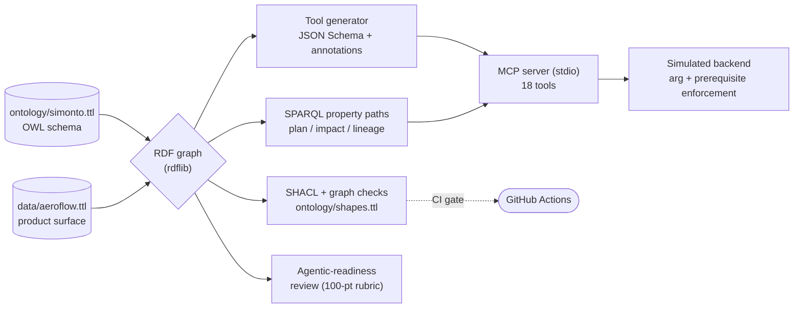
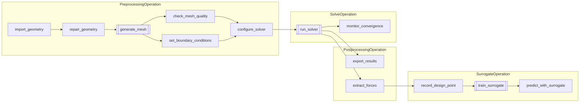

# SimOnto

**Make a simulation product AI-accessible: describe its scripting surface as an ontology, validate it with SHACL, and generate typed agent tools (MCP) from it.**

Simulation tools have powerful programmatic surfaces (scripting APIs, file formats, workflow logic) that were never designed for AI consumption. An agent that is handed a pile of function names will guess at parameter units, skip prerequisite steps, and overwrite files. SimOnto treats that as a *modeling* problem: put the knowledge in a governed ontology once, and derive everything an agent needs from it.

> **Scope note.** The product in this repo, *AeroFlow*, is **fictional**, and its backend is **simulated** (analytic formulas plus deterministic pseudo-noise, every result flagged `"simulated": true`). No real vendor API, file format or confidential data is used. What is real is the pipeline: ontology, SHACL gate, SPARQL reasoning, tool generation, contract enforcement and a working MCP server.

## What it does



| Capability | Where | What it shows |
|---|---|---|
| **Ontology schema** | `ontology/simonto.ttl` | OWL classes (`Operation` and four subclasses, `Parameter`, `DataArtifact`, `FileFormat`), a **transitive** `requiresOperation`, inverse properties, typed datatype properties |
| **Product knowledge graph** | `data/aeroflow.ttl` | 13 operations, 30 typed parameters, 14 data artifacts, ~670 triples across geometry, meshing, solve, post-processing and surrogate steps |
| **Quality gate** | `ontology/shapes.ttl`, `validate.py` | SHACL rules (description length, units on numerics, enums with values, required examples, side-effect flags) plus checks SHACL cannot express: prerequisite cycles, dangling data inputs, defaults outside bounds |
| **Reasoning** | `planner.py`, `queries/*.rq` | "What must run first?" and "what breaks if I change this?" answered by SPARQL property paths, not hand-written orchestration |
| **Agent tools** | `toolgen.py` | Strict JSON Schema (types, units, min/max, enums, defaults, `additionalProperties:false`) and MCP annotations (`readOnlyHint`, `destructiveHint`, `idempotentHint`) generated from the graph |
| **MCP server** | `mcp_server.py` | Dependency-free JSON-RPC 2.0 over stdio: `initialize`, `tools/list`, `tools/call`, `ping`; 13 operation tools, 5 ontology meta-tools, protocol-level `dry_run` |
| **Contract enforcement** | `backend.py` | Rejects bad arguments with units and ranges, blocks calls whose inputs do not exist yet, returns structured errors with a recovery hint |
| **Readiness review** | `readiness.py` | Scores each operation 0-100 so ontology authors can review products for "agentic readiness" |

## Quickstart

```bash
pip install -e ".[dev]"      # rdflib + pyshacl (+ pytest)
python -m simonto validate   # SHACL + graph checks
python -m simonto demo       # scripted agent: fails, asks the ontology, recovers, finishes
python -m pytest -q          # 34 tests, incl. an end-to-end MCP subprocess test
```

Use it from an MCP client (for example Claude Desktop):

```json
{ "mcpServers": { "simonto-aeroflow": { "command": "simonto", "args": ["serve"] } } }
```

## Example: an agent recovers using the ontology

```text
> predict_with_surrogate {"inlet_velocity": 60, "angle_of_attack": 4}
  ERROR missing_prerequisite: predict_with_surrogate needs SurrogateModel, which does not exist in this session yet
  hint: call ontology_plan_workflow with goal='predict_with_surrogate' to get the ordered steps

> generate_mesh {"global_size": 0.01}
  ERROR invalid_arguments: 'global_size'=0.01 is below the minimum 0.1 mm
```

`ontology_plan_workflow` then returns the 11-step chain (import, repair, mesh, quality check, boundary conditions, solver set-up, run, extract forces, record design point, train surrogate, predict) with example arguments, and the agent executes it. Run `python -m simonto demo` to see the full transcript.

Prerequisite graph generated from the ontology (`python -m simonto diagram`; double-bordered = long running):



## Reviewing a product for agentic-readiness

The same tooling reviews *someone else's* surface. `data/legacy_sample.ttl` is a deliberately poor as-found description:

```text
$ python -m simonto --data data/legacy_sample.ttl validate    # fails: 11 SHACL errors + 1 dangling input
$ python -m simonto --data data/legacy_sample.ttl readiness
 25  run_it    description is 8 chars; thin parameter descriptions; missing unit: n; missing min/max: n; enum without allowed values; no output artifact declared
 85  report    consumes RunOutput without a declared prerequisite that produces it
overall 55.0 / 100
```

AeroFlow itself scores 99.1 / 100 (`docs/readiness_report.md`). The report is honest about what is left: `random_seed` and `outlet_pressure` have no bounds.

## SPARQL examples (`queries/`)

```bash
python -m simonto query -f queries/prerequisites_of.rq      # transitive prerequisites of run_solver
python -m simonto query -f queries/unsafe_operations.rq     # destructive or long-running: confirm first
python -m simonto query -f queries/artifact_lineage.rq      # who produces / consumes each artifact
python -m simonto query -f queries/parameters_with_units.rq # the numeric contract: unit + safe range
```

## Design decisions

- **The graph is the single source of truth.** Tool schemas, plans, docs and scores are derived; nothing is maintained twice. CI fails if `docs/` is stale.
- **Prerequisites as a transitive property.** `requiresOperation` is declared `owl:TransitiveProperty` and queried with `+` property paths, so adding one edge updates every plan and impact analysis.
- **Side effects are first-class.** `isDestructive`, `isIdempotent`, `isLongRunning` and `isReadOnly` are mandatory facts (SHACL-enforced) that map directly onto MCP tool annotations.
- **Errors are designed for agents.** Every failure carries a code, the violated constraint with units, and a next-step hint, so recovery does not need a human.
- **Ontology vs. product data are separate files.** Swapping `data/aeroflow.ttl` for another product's description reuses the schema, shapes, generator, planner and server unchanged (`--data`).
- **No framework lock-in.** The MCP layer is about 150 lines of stdlib; the same tool definitions can be adapted to LangChain / LangGraph tools or OpenAPI.

## Limitations (deliberate)

- The backend is a simulation; swapping in a real API means implementing one method per operation behind `SimulatedBackend.call`.
- No OWL reasoner is run; subclass handling relies on RDFS inference in SHACL and SPARQL paths. An OWL-RL pass is a natural next step.
- Stdio transport only; no auth, sessions per client, or streaming progress for long-running operations.
- The readiness rubric is a documented heuristic, not a measure of actual agent success rates.

## Roadmap

1. Parse a real scripting API (docstrings / OpenAPI / stubs) into draft ontology triples for human review.
2. Retrieval layer: embed operation and parameter descriptions in a vector store and combine with graph neighbourhoods (GraphRAG) for tool selection.
3. Agent evals: measure tool-selection accuracy and error-recovery rate with and without the ontology-derived context.
4. Ontology-versioned tool manifests with breaking-change detection between releases.

## Repo layout

```text
ontology/   simonto.ttl (OWL schema), shapes.ttl (SHACL)
data/       aeroflow.ttl (fictional product), legacy_sample.ttl (poor example)
queries/    SPARQL examples
src/simonto graph, validate, planner, toolgen, readiness, backend, mcp_server, cli
tests/      34 tests (ontology, planner, tool generation, backend, readiness, MCP e2e)
docs/       generated: tools.json, workflow.mmd, readiness_report.md
```

MIT licensed. Author: Bipin Pandey.
